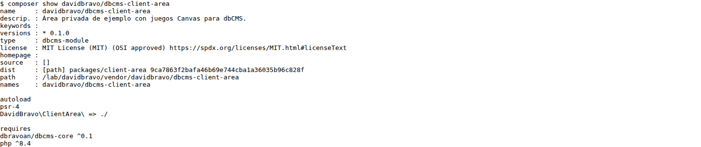
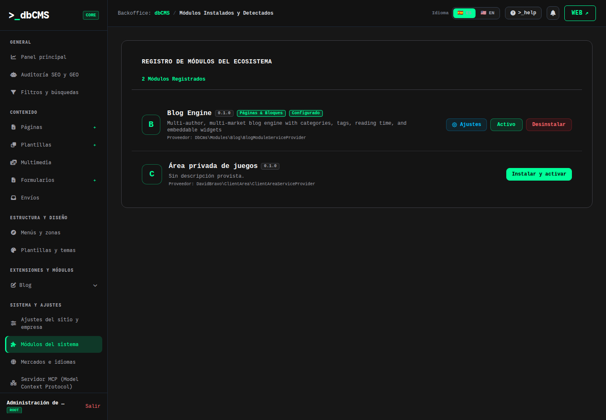
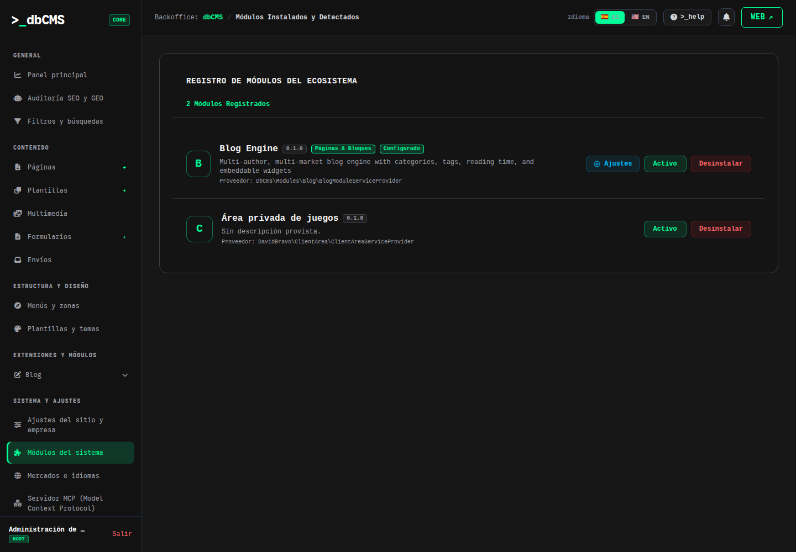
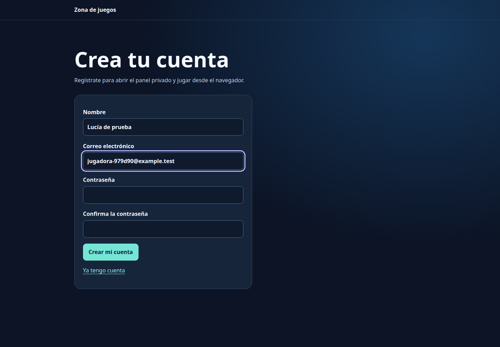
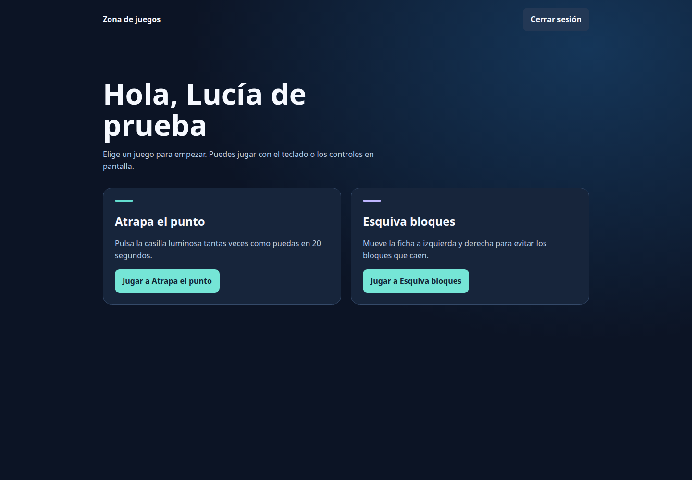
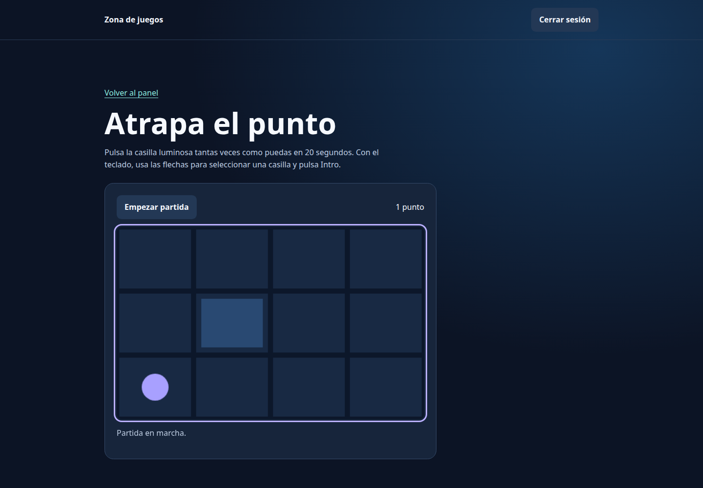
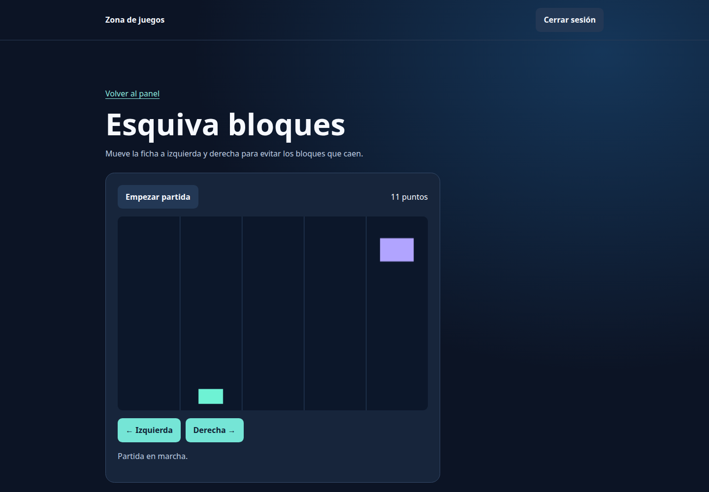
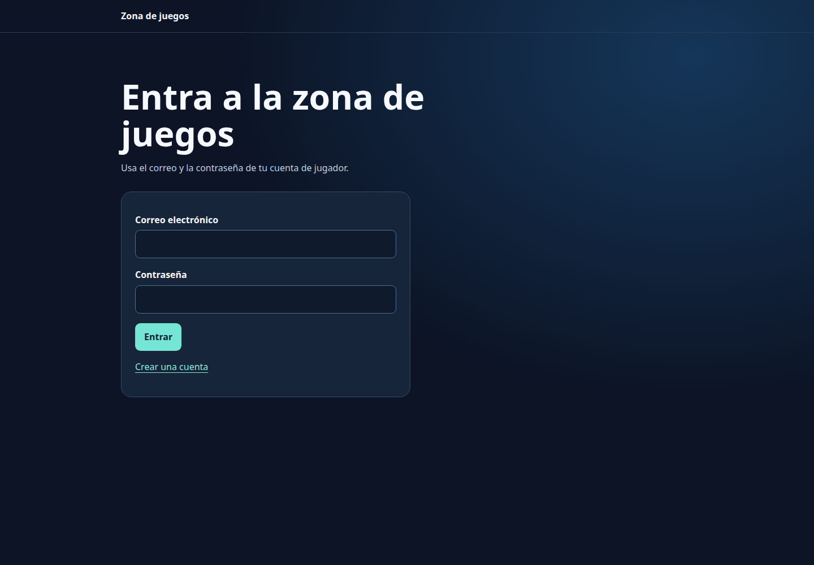

# Cómo crear un área privada con juegos Canvas en dbCMS

Crea un módulo local para que una persona se registre, inicie sesión y acceda a dos juegos desde el navegador. Usa una [web de prueba](HOW_TO_START.md).

## 1. Define el paquete y sus límites

Lee el `AGENTS.md` de tu web y consulta el contrato de extensiones de Core. Usa el [paquete de ejemplo](examples/client-area) para ver cómo `BaseModuleServiceProvider::registerModuleAuth()` configura el guard y cómo el módulo protege sus rutas.

| Archivo del paquete | Responsabilidad |
| --- | --- |
| `composer.json` | Declara el tipo `dbcms-module`, el identificador `client_area` y el proveedor. |
| `ClientAreaServiceProvider.php` | Registra el guard de sesión `client_area` y las rutas cuando el módulo está activo. |
| `Database/Migrations/` y `Models/Player.php` | Guardan los datos de los jugadores en `client_area_players`, con correo único y contraseña hasheada. |
| `Routes/web.php` y `Http/` | Validan el registro, gestionan la sesión y protegen el panel y las rutas de cada juego. |
| `Resources/views/` | Muestran los formularios, las dos tarjetas del panel y los juegos Canvas. |

Las rutas públicas permiten registrar una cuenta o iniciar sesión. Las rutas privadas usan el guard del módulo; un visitante sin sesión pasa a `/zona-juegos/entrar`. El registro, la entrada y la salida usan formularios POST con CSRF. Se limita la frecuencia de los intentos y se regenera la sesión al entrar y al salir.

## 2. Instala el módulo en tu web

Copia la carpeta [client-area](examples/client-area) en `packages/client-area` de una web de prueba. Ejecuta Composer desde la raíz de esa web. Con Sail, antepón `./vendor/bin/sail`.

```bash
composer config repositories.client-area '{"type":"path","url":"packages/client-area","options":{"symlink":false,"versions":{"davidbravo/dbcms-client-area":"0.1.0"}}}'
composer require davidbravo/dbcms-client-area:^0.1 --no-interaction
```

Comprueba el tipo y la versión del paquete con `composer show davidbravo/dbcms-client-area`.



Abre **Sistema y ajustes → Módulos del sistema**. Busca **Área privada de juegos** y pulsa **Instalar y activar**. Core ejecuta la migración del paquete y lo activa.





## 3. Prueba el registro y el acceso privado

En una ventana sin sesión, abre `/zona-juegos` o entra en la URL de un juego. La aplicación te lleva al formulario de entrada. Selecciona **Crear una cuenta** y usa datos de prueba.


Completa el formulario, confirma una contraseña de al menos diez caracteres y pulsa **Crear mi cuenta**. La cuenta se crea y el panel abre las dos opciones de juego.





## 4. Juega y cierra la sesión

En **Atrapa el punto**, pulsa **Empezar partida**. Toca el círculo o usa las flechas e **Intro** para sumar un punto. En **Esquiva bloques**, usa las flechas o los botones para mover la ficha mientras caen los obstáculos.





Pulsa **Cerrar sesión** y vuelve a solicitar la URL privada. Comprueba que redirige a **Entrar** y que puedes iniciar sesión de nuevo.



Comprueba que la cuenta de jugador vuelve al formulario de acceso al abrir `/admin` y que el registro exige CSRF. La puntuación se calcula en Canvas y dura lo que dura la partida.
