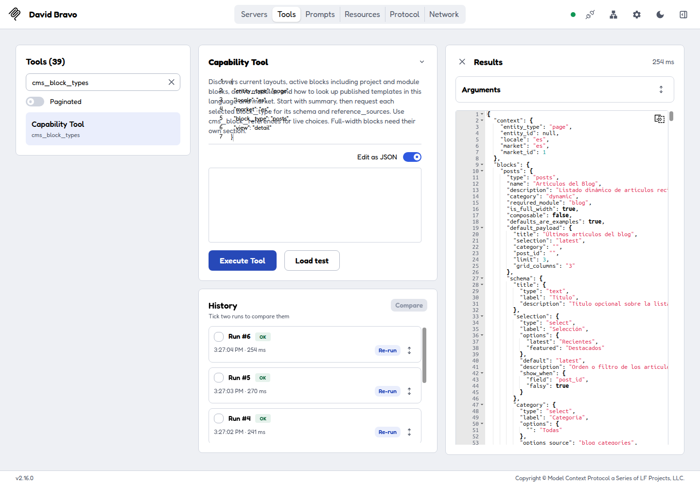
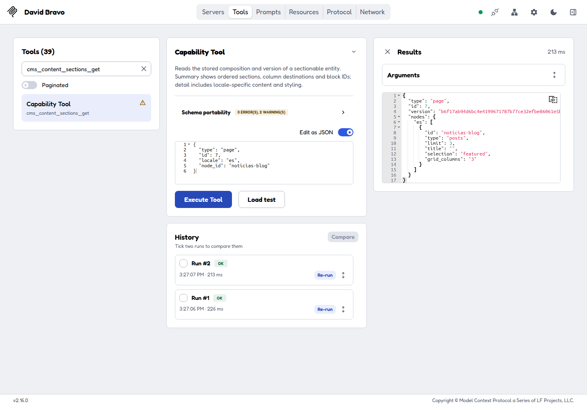
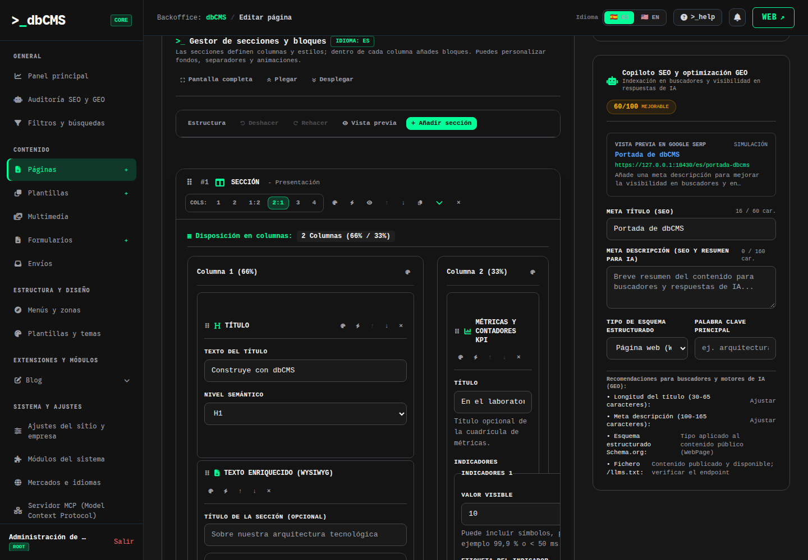
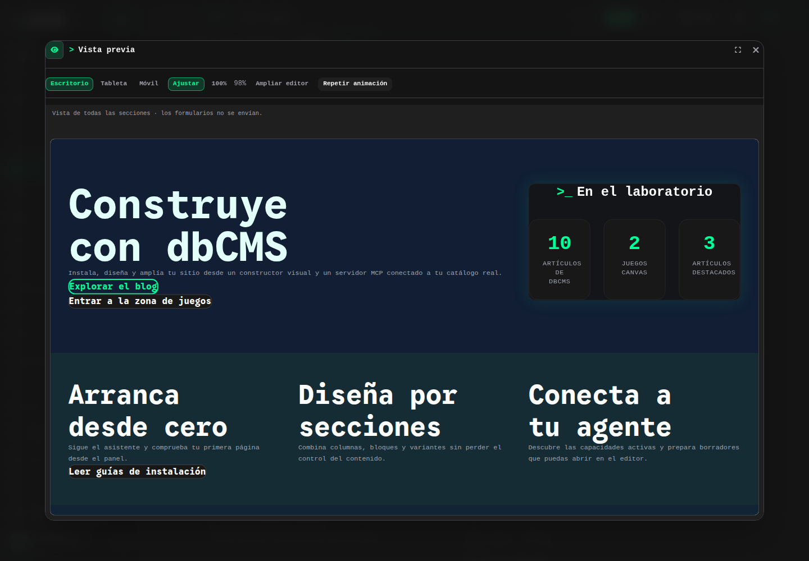
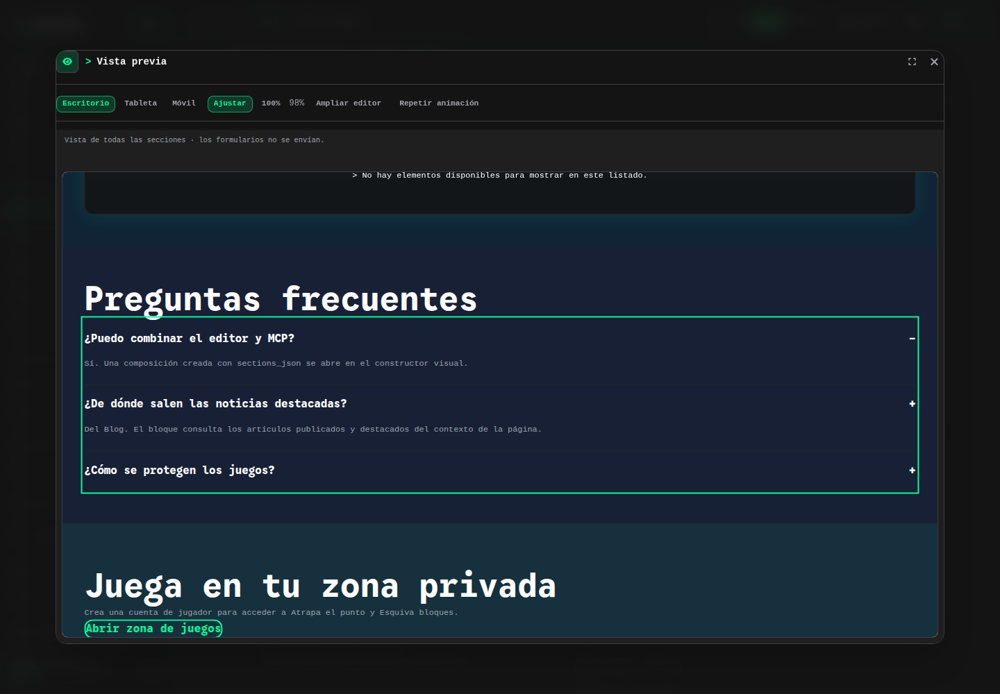
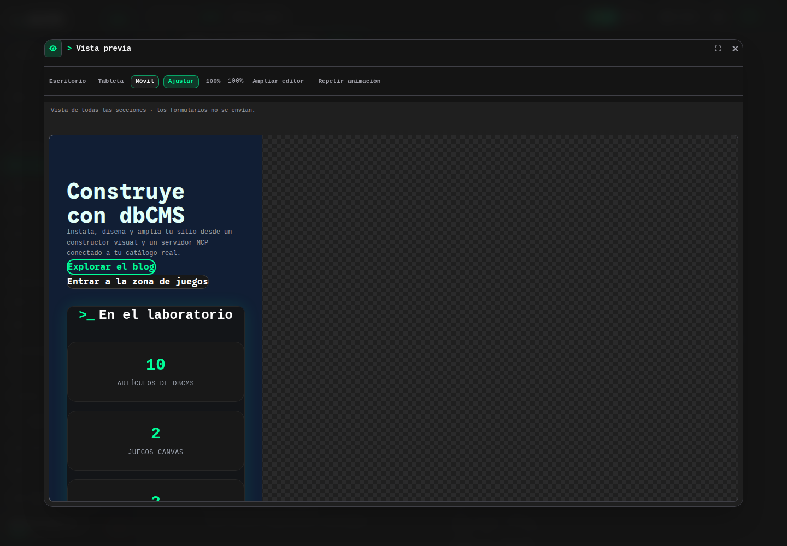
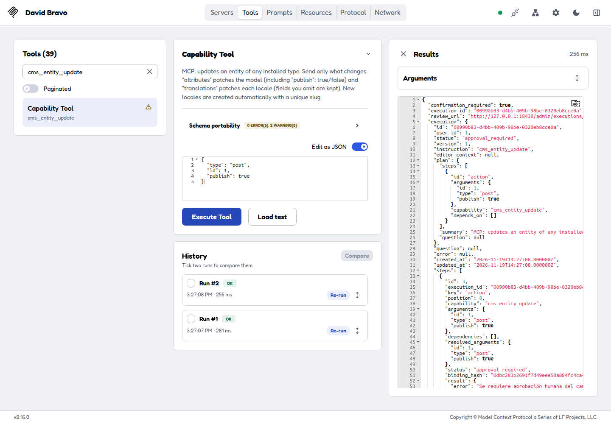
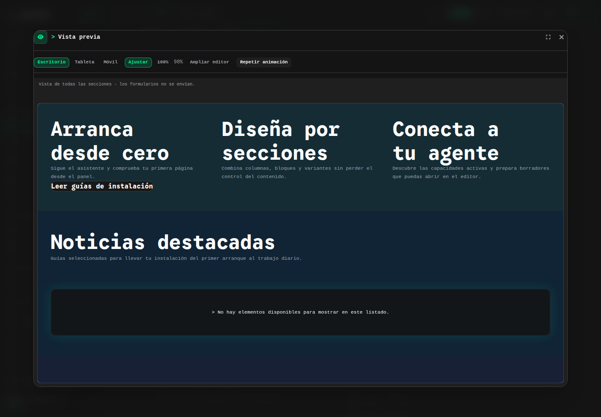
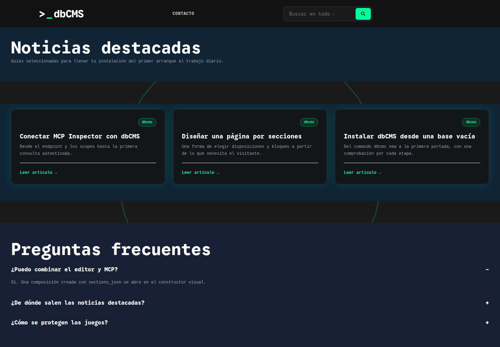

# Cómo crear una portada con animaciones y noticias destacadas desde MCP

Crea un borrador de portada que puedas abrir en el constructor de dbCMS. Usa el tema `db-cyber`, Blog, los [artículos del ejemplo MCP](HOW_TO_MCP.md) y el [módulo de juegos](HOW_TO_BUILD_CLIENT_AREA.md). La composición incluye una apertura asimétrica, tres columnas de orientación, un listado de noticias y un acordeón.

## 1. Descubre el catálogo del sitio

Sigue la [guía de MCP](HOW_TO_MCP.md) para emitir un token de escritura. La cuenta asociada necesita `manage:pages` para crear la portada. Ejecuta `cms_block_types`.

```json
{"entity_type":"page","locale":"es","market":"es","view":"summary"}
```

Lee `composition.layouts` para elegir las proporciones. El ejemplo usa `2-1`, `3` y `1`. Comprueba que Blog esté activo y que el catálogo anuncie `posts` y `rich_text`. Puedes consultar las plantillas con la herramienta y los argumentos de `templates`.

Para revisar un bloque concreto, vuelve a llamar a `cms_block_types` con `view: "detail"` y `block_type`. Consulta `appearance.presentation_properties` para ver animaciones y opciones de presentación. En `posts`, comprueba los campos de `selection`, `limit` y `grid_columns`. El catálogo señala que ese bloque necesita una sección propia.



## 2. Decide la función de cada sección

| Sección | Composición y comportamiento |
| --- | --- |
| Presentación | Disposición `2-1`. El título, el texto y dos llamadas a la acción ocupan la columna ancha. La otra contiene métricas del ejemplo. Entra con `fadeInUp`. |
| Tres puntos de partida | Disposición `3`. Instalación, diseño y MCP tienen su propia columna. La sección entra con `fadeInLeft`. |
| Noticias destacadas | Disposición `1`. Un título y un texto presentan las guías seleccionadas. |
| Parrilla del blog | Disposición `1` con un único bloque `posts`. Consulta destacados y devuelve hasta tres tarjetas con título, resumen y enlace. |
| Preguntas frecuentes | Disposición `1`. Un acordeón agrupa preguntas sobre el constructor, Blog y el área privada. La sección usa `zoomIn`. |
| Invitación a jugar | Disposición `1`. El botón conduce a `/zona-juegos`, la ruta del módulo de juegos. |

Los fondos, el espaciado y las animaciones se guardan con sus bloques y secciones. La tipografía del titular tiene un tamaño de escritorio y otro definido en `appearance.mobile`. Los enlaces apuntan al Blog y al área de juegos.

## 3. Guarda y consulta el borrador

Abre `cms_entity_create` y pega el [JSON completo de la portada](how-to-homepage-mcp/portada-mcp.json). El cuerpo está en `sections_json.es`. Cada sección lleva `type: "text"` y `columns_layout`. Los bloques `rich_text` y los demás bloques viven en `columns[].blocks` y en las zonas anidadas que declara su esquema.

Usa el identificador devuelto en `cms_content_sections_get` con `type: "page"`, `locale: "es"` y `view: "summary"`. Comprueba las seis secciones, las columnas y los bloques. Una segunda lectura con `node_id: "noticias-blog"` verifica el ajuste `selection: "featured"` y el límite de tres.



Para corregir un bloque concreto, lee la última `version` y envía `cms_content_sections_patch` con su ID. Si creas la página como portada de una web nueva, puedes usar el slug `home` cuando esté libre. Usa `portada-dbcms` para revisar este ejemplo por separado.

## 4. Verifica el diseño y el movimiento

En **Páginas**, abre **Portada de dbCMS**. Usa **Vista previa** en la barra del constructor para renderizar toda la composición. Pulsa **Repetir animación**, desplázate hacia las siguientes secciones y prueba las preguntas del acordeón. Selecciona **Móvil** para verificar el apilado de columnas y el tamaño del título.









## 5. Revisa la publicación y comprueba los resúmenes

El bloque `posts` consulta Blog al renderizar la página. Para aparecer, un artículo debe estar publicado, marcado como destacado y disponible en el idioma y mercado de la página. Para solicitar su publicación con MCP, llama a `cms_entity_update` con `type: "post"`, el `id` del artículo y `publish: true`, usando una cuenta con `manage:posts`. Abre el `review_url` de la respuesta con una cuenta autorizada y revisa el contenido antes de aprobar.



Con los artículos aún en borrador, la sección presenta el título y el texto introductorio. El bloque completa las tarjetas cuando encuentra artículos elegibles.



Reabre la vista previa cuando los tres artículos estén publicados. Comprueba que cada tarjeta muestra su título, resumen y enlace al Blog.


