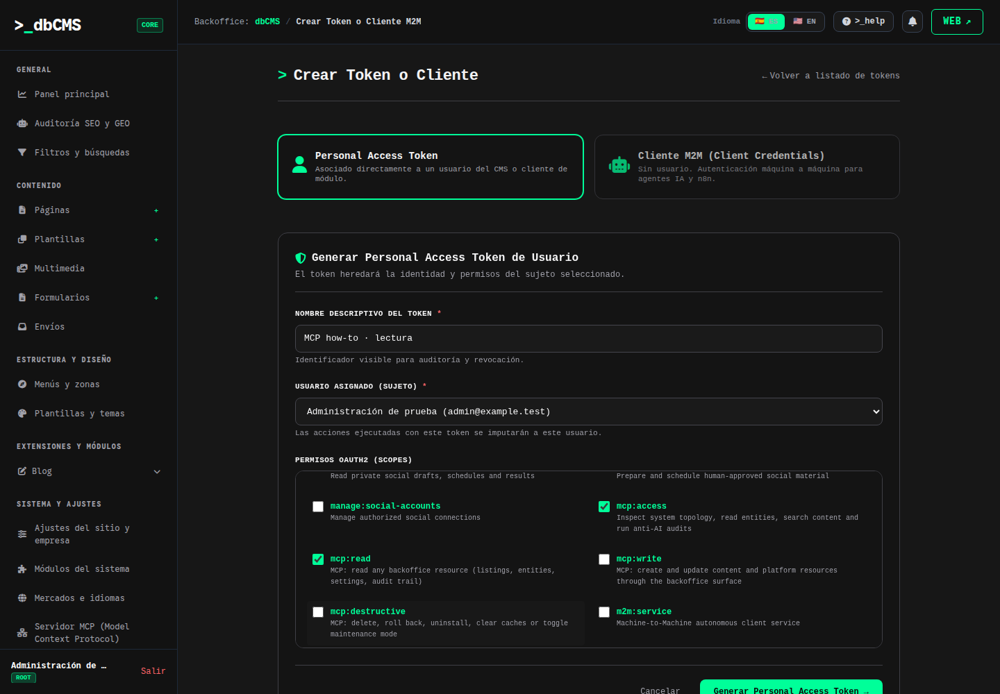

# Conectar MCP y crear un blog por secciones

Usa una instalación de prueba con Blog activo, mercado `es` e idioma español. El ejemplo crea una categoría y diez borradores. [Preparar la web](HOW_TO_START.md)

## 1. Conecta un cliente con acceso de lectura

En **Sistema y ajustes → Servidor MCP**, habilita el servidor y copia su endpoint. La ruta es `/mcp/cms`. Usa HTTPS para una instalación remota.

Pulsa **Emitir token Passport → Personal Access Token**. Selecciona la cuenta que actúa en dbCMS y concede `mcp:access` y `mcp:read`. Copia el token y guárdalo en el gestor de credenciales del cliente.



Configura el cliente con transporte **Streamable HTTP**, la URL completa y la cabecera `Authorization: Bearer TU_TOKEN`. Por ejemplo, abre MCP Inspector con el siguiente comando y añade el servidor desde su interfaz. [Documentación de MCP Inspector](https://github.com/modelcontextprotocol/inspector/blob/main/README.md)

```bash
npx @modelcontextprotocol/inspector
```

Ejecuta `cms_capabilities` con argumentos vacíos para ver las operaciones de esa cuenta. Consulta tus páginas publicadas con `cms_entity_list`.

```json
{"type":"page","status":"published","per_page":5}
```

## 2. Descubre el esquema y crea la categoría

Emite otro token personal con `mcp:access`, `mcp:read` y `mcp:write` para una cuenta con `manage:posts`. Conecta una segunda sesión. Ejecuta `cms_entity_types` y busca `blog_category` y `post`.

Llama a `cms_entity_create` con estos argumentos. Guarda el `id` de la respuesta.

```json
{
  "type": "blog_category",
  "attributes": {"is_active": false},
  "translations": {
    "es": {
      "name": "dbCMS",
      "slug": "dbcms",
      "description": "Guías prácticas de instalación, módulos, edición y MCP."
    }
  }
}
```

## 3. Crea los artículos con el constructor

Pide el catálogo de la composición a `cms_block_types`. Para leer el esquema de Rich Text, usa `view: "detail"` y `block_type: "rich_text"`.

```json
{"entity_type":"post","locale":"es","market":"es","view":"summary"}
```

Abre los [diez payloads JSON](how-to-mcp/ejemplos-borradores.json) y sustituye `attributes.category_id` por el ID de tu categoría. Envía un objeto por llamada a `cms_entity_create`. El título, el slug y el resumen van en `translations.es`. El cuerpo va en `sections_json.es` y los bloques `rich_text` declaran su `format` y `content`. Tres artículos llevan `is_featured: true` para el ejemplo de portada.

## 4. Revisa y edita los borradores

Llama a `cms_content_sections_get` con `type: "post"`, el `id` del artículo, `locale: "es"` y `view: "summary"`. Revisa las tres secciones en `layout.es`. Usa `version` y el ID del bloque en `cms_content_sections_patch` para corregir un campo. Reserva `cms_content_sections_sync` para sustituir la composición completa.

Consulta los borradores con `cms_entity_list` y comprueba que cada uno apunta a la categoría que creas en el paso 2.

```json
{"type":"post","locale":"es","status":"draft","per_page":20}
```

Abre **Blog → Categorías** y **Blog → Artículos del blog** para revisar el contenido en el panel. Al solicitar publicación, abre el `review_url` con una cuenta autorizada y revisa el cambio. Si la cola usa el driver `database`, mantén `php artisan queue:work database` activo en el entorno de la aplicación y comprueba el estado de la ejecución.

## 5. Cierra las sesiones de prueba

Desconecta el cliente y retira la cabecera `Authorization` de su configuración. En el listado de tokens, **Revocar Token** abre la confirmación. Si el formulario responde HTTP 405, la ruta `POST /<ruta-admin>/tokens/{id}/revoke` permite revocar con sesión administrativa, permiso `manage:tokens` y CSRF. Confirma la etiqueta **Revocado** y comprueba que el token devuelve HTTP 401.

- [Crear una portada con bloques y noticias destacadas](HOW_TO_BUILD_HOMEPAGE_MCP.md).
- [Crear landings con Rich Text por secciones o Blade](https://github.com/dbravoan/dbcms-core/blob/main/docs/HOW_TO_RICH_TEXT_LANDINGS.md).
